# Отчёт ЛР1

## Цель работы

Сделать маленький простой сервис (сам или сгенерировать) и поднять для него полный мониторинг: метрики, логи и трейсы.

# Часть 1

В этой части нужно было сделать сайтик с 3 кнопками, которые будут выкидывать разные ответы. При помощи ChatGPT был написан на FastAPI такой сервис.

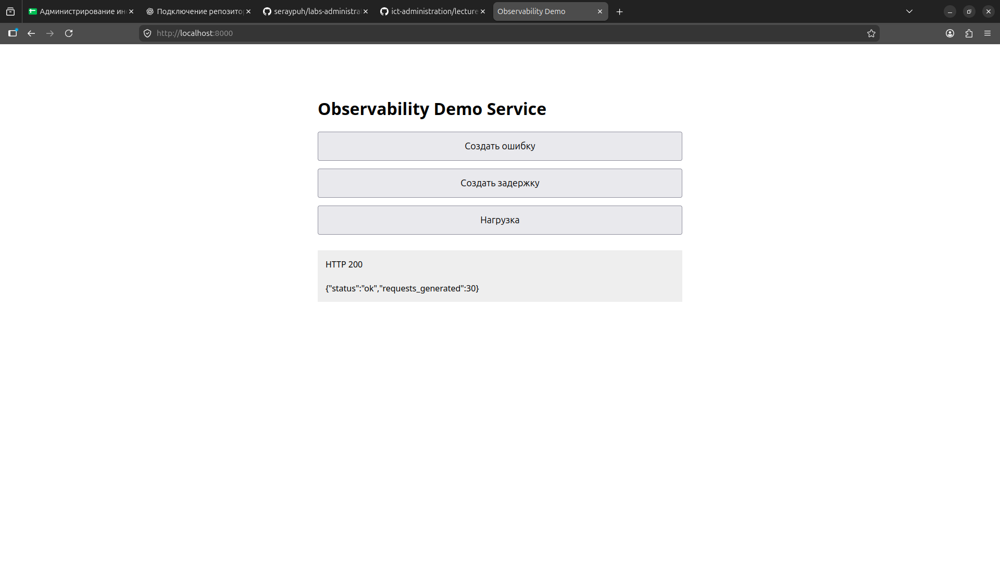

В эндпоинт `/metrics` отдаются метрики в формате Prometheus, и логи в формате JSON. Запускается через Docker.

# Часть 2

Для поднятия Prometheus и Grafana пришлось начинать писать *docker-compose.yml*.

```
services:
  app:
    build: .
    container_name: observability-app
    ports:
      - "8000:8000"

  prometheus:
    image: prom/prometheus
    container_name: prometheus
    ports:
      - "9090:9090"
    volumes:
      - ./prometheus/prometheus.yml:/etc/prometheus/prometheus.yml
    depends_on:
      - app

  grafana:
    image: grafana/grafana
    container_name: grafana
    ports:
      - "3000:3000"
    volumes:
      - grafana-data:/var/lib/grafana
    depends_on:
      - prometheus

volumes:
  grafana-data:
```


### Prometheus
Для него нужно было создать в корне проекта папку *prometheus*, а в ней *prometheus.yml* со следующим содержанием:

```
global:
  scrape_interval: 5s

scrape_configs:
  - job_name: "observability-demo"
    static_configs:
      - targets: ["app:8000"]
```

*scrape_interval* - то как часто Prometheus обращается к эндпоинту */metrics*.

Prometheus находится на порту 9090 согласно *docker-compose.yml*.

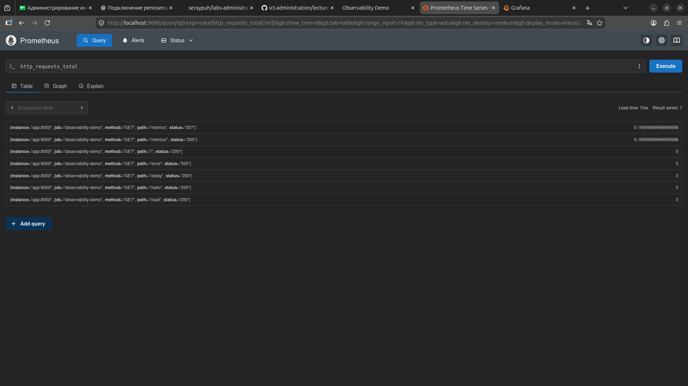

### Grafana
Для поднятия Grafan-ы нужно добавить её docker-compose. Там же указывается что она на порту 3000.

При первом входе в Grafan-у встречает авторизация, по умолчанию логин admin, пароль admin.

В графане создаётся dashboard, на котором уже создаются панели -- те самые графики по данным от прометеуса (RED).

1. Request Rate (RPS) 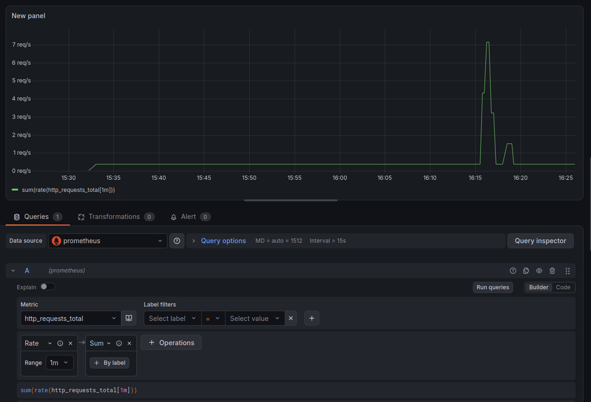

2. Error Rate в процентах 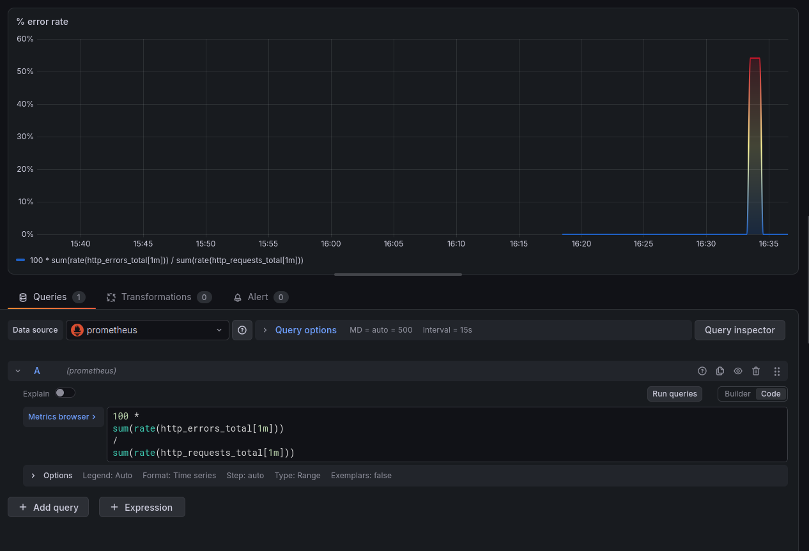

3. Response Time (p95) 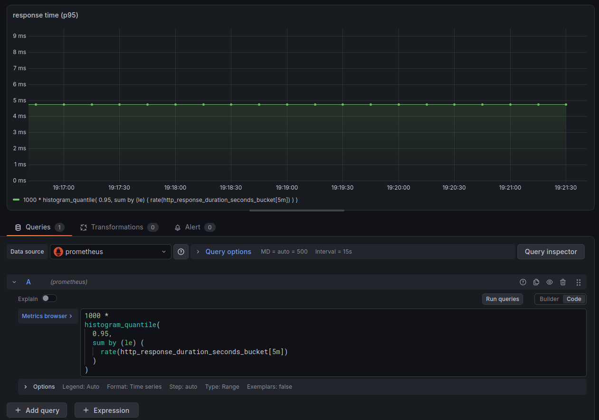

Итоговый дэшборд из трёх графиков:

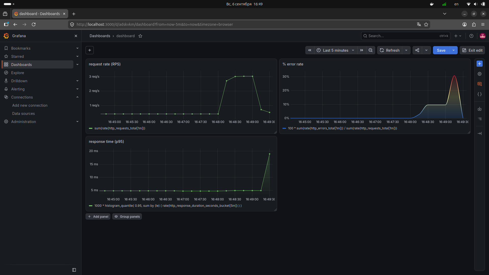

# Часть 3

Для поднятия Loki и Promtail (у которого прекращена поддержка, если верить ChatGPT) необходимо создать папки в корне проекта с названиями *loki* и *promtail*, а в них создать файлы *loki-config.yml* и *promtail-config.yml*.

*loki-config.yml:*

```
auth_enabled: false

server:
  http_listen_port: 3100

common:
  path_prefix: /loki

  ring:
    instance_addr: 127.0.0.1
    kvstore:
      store: inmemory

  replication_factor: 1

  storage:
    filesystem:
      chunks_directory: /loki/chunks
      rules_directory: /loki/rules

schema_config:
  configs:
    - from: 2024-01-01
      store: tsdb
      object_store: filesystem
      schema: v13
      index:
        prefix: index_
        period: 24h

limits_config:
  allow_structured_metadata: true
  volume_enabled: true

ruler:
  enable_api: true
```

*promtail-config.yml*

```
server:
  http_listen_port: 9080

positions:
  filename: /tmp/positions.yaml

clients:
  - url: http://loki:3100/loki/api/v1/push

scrape_configs:

  - job_name: docker

    static_configs:
      - targets:
          - localhost

        labels:
          job: docker
          __path__: /var/lib/docker/containers/*/*-json.log
```

Также они добавляются в *docker-compose.yml* (полный файл в конце отчёта), а также у loki добавляется volume в docker-compose, чтобы не терялись данные после перезапуска.

```
  loki:
    image: grafana/loki:3.7.0
    container_name: loki
    ports:
      - "3100:3100"
    volumes:
      - ./loki/loki-config.yml:/etc/loki/config.yml
      - loki-data:/loki
    command: -config.file=/etc/loki/config.yml

  promtail:
    image: grafana/promtail:3.7.0
    container_name: promtail
    volumes:
      - ./promtail/promtail-config.yml:/etc/promtail/config.yml
      - /var/lib/docker/containers:/var/lib/docker/containers:ro
    command: -config.file=/etc/promtail/config.yml
    depends_on:
      - loki
      
ну и в volumes loki-data
```


В Grafana в Data sources добавляем Loki, и во вкладке Explore появляются логи от Локи.

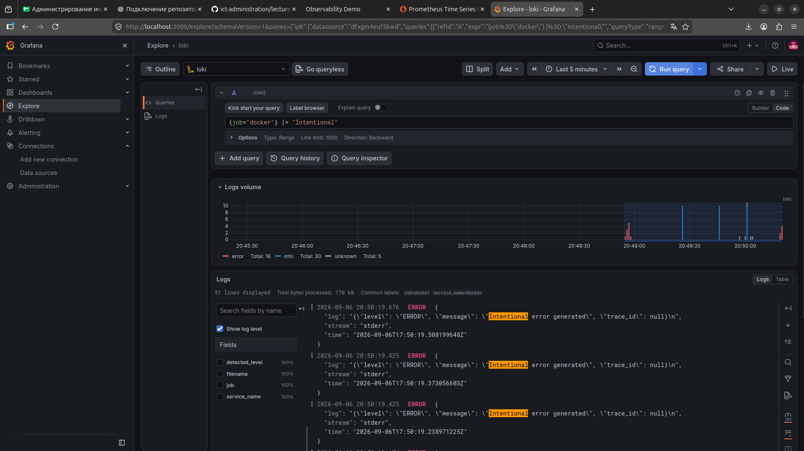

# Часть 4

Дальше нужно было добавить OpenTelemetry Collector + Jaeger. В этой части я поплыл, не понимал природу возникавших ошибок, и вряд ли бы справился без нейронки (зато честно). Это было из-за того, что нужно было редактировать код *main.py*, который я не писал, причём с использованием библиотек, с которыми я столкнулся впервые.

Но всё-таки кое-как я справился, и далее расскажу что пришлось сделать.

### OpenTelemetry Collector

Вначале нужно было изменить код в *main.py* чтобы добавить TracerProvider, OTLP exporter, настроить инструментирование, добавить вложенный span для задержки, пометить /error как ошибку и добавить trace_id в логах. Это было выполнено ChatGPT, потому что в код приложения я не вникал, так как этого не требует задание.


Справедливости ради я разобрался в этих понятиях:

- TracerProvider -- отвечает за то откуда приложение берет трейсеры
- OTLP Exporter -- вытаскивает spans из приложения и отправляет их в OTel Collector
- Инструментирование -- ппо сути, внедрение в приложение создание span-ов от каждого действия
- trace_id -- айди трейса, позволяющий его идентифицировать как в Loki, так и в Jaeger

Далее добавляем эндпоинт `http://otel-collector:4317` для OTel Exporter, ну и сам collector в *docker-compose.yml*

```
  otel-collector:
    image: otel/opentelemetry-collector-contrib:latest
    container_name: otel-collector
    ports:
      - "4317:4317"
      - "4318:4318"
    volumes:
      - ./otel-collector-config.yml:/etc/otelcol-contrib/config.yaml
    command:
      - "--config=/etc/otelcol-contrib/config.yaml"
```

Создаём в корне проекта файл *otel-collector-config.yml*:

```
receivers:
  otlp:
    protocols:
      grpc:
        endpoint: 0.0.0.0:4317
      http:
        endpoint: 0.0.0.0:4318

exporters:
  debug:
    verbosity: detailed

service:
  pipelines:
    traces:
      receivers:
        - otlp
      exporters:
        - debug
```

Теперь мы снова возвращаемся к *docker-compose.yml* чтобы добавить в основной контейнер приложения

```
    environment:
      OTEL_EXPORTER_OTLP_ENDPOINT: http://otel-collector:4317

    depends_on:
      - otel-collector
```

### Jaeger

Сначала добавим Jaeger в docker-compose:

```
  jaeger:
    image: jaegertracing/jaeger:2.20.0
    container_name: jaeger

    ports:
      - "16686:16686"
```

Затем изменяем конфиг *otel-collector-config.yml*: добавляем в exporters jaeger. 

```
receivers:
  otlp:
    protocols:
      grpc:
        endpoint: 0.0.0.0:4317
      http:
        endpoint: 0.0.0.0:4318


exporters:
  debug:
    verbosity: detailed

  otlp/jaeger:        <-весь блок новый
    endpoint: jaeger:4317
    tls:
      insecure: true


service:
  pipelines:
    traces:
      receivers:
        - otlp

      exporters:
        - debug
        - otlp/jaeger <-новое
```

Теперь всё работает (после перезапуска). UI Jaeger-а открывается через порт 16686, это указано в *docker-compose.yml*. Подключаем в нём наше приложение, в приложении жмём на кнопку задержки и смотрим на график.

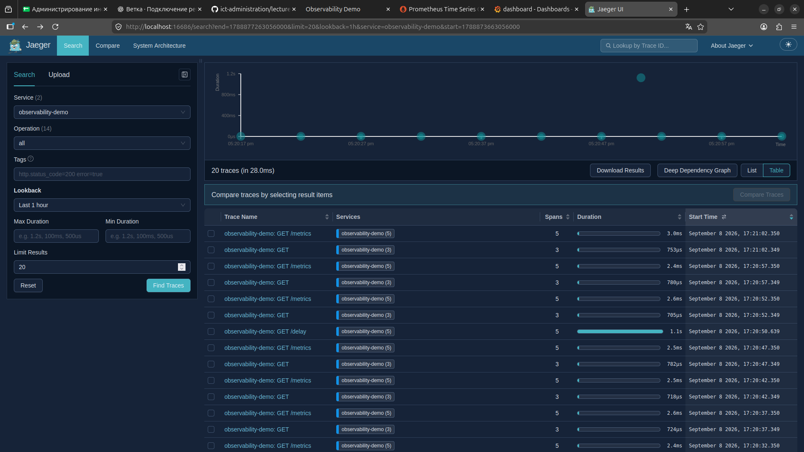

Один пузырик улетел в космос, это и есть наша задержка.

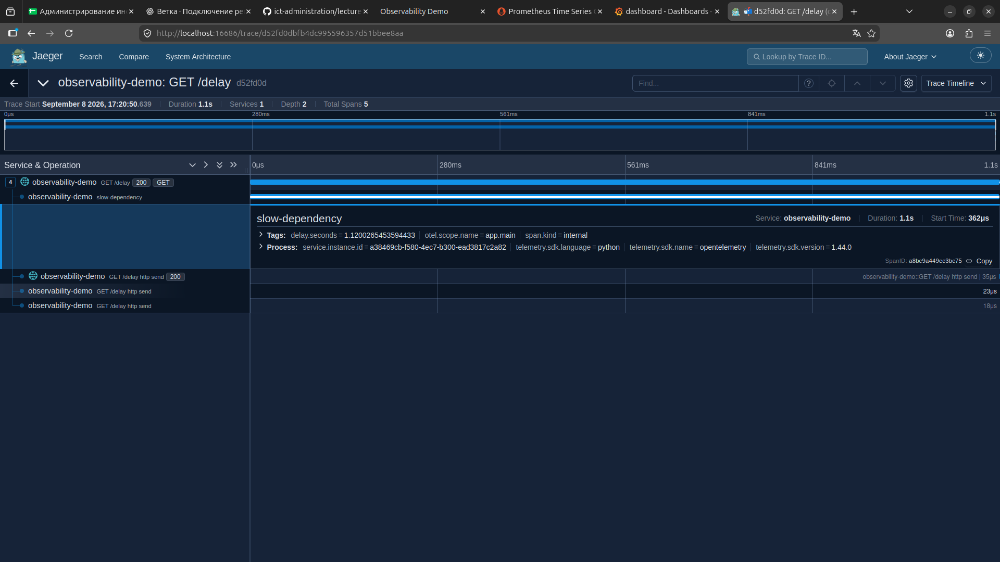

Видно, что slow-dependency сожрал почти всё время.

Теперь в приложении тыкаем на ошибку, и идём в Graphan-у в Loki.

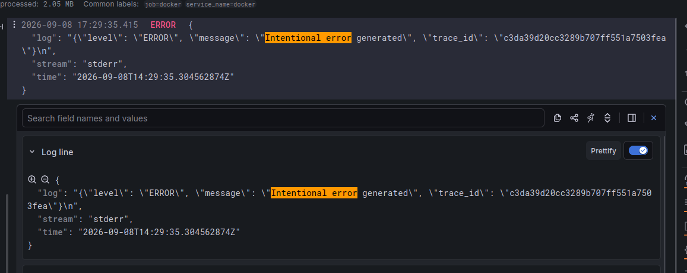

Ошибка найдена, копируем её trace-id и идём в Jaeger.

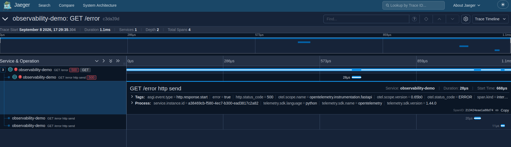

В поиске по trace-id она была найдена.

# Часть 5

В последней части нужно было создать алерты и подключить Alertmanager. Как получатель был выбран самый простенький вебхук на питоне (*webhook.py* в корне проекта).

Вначале сами алерты описываются в файле *alert_rules.yml*, расположенный в корне проекта:

```
groups:
  - name: observability-alerts

    rules:

      - alert: HighErrorRate
        expr: |
          100 *
          sum(rate(http_errors_total[1m]))
          /
          sum(rate(http_requests_total[1m]))
          > 5
        for: 30s
        labels:
          severity: warning
        annotations:
          summary: "Высокая доля ошибок"
          description: "Доля HTTP-ошибок выше 5%"

      - alert: HighRequestRate
        expr: |
          sum(rate(http_requests_total[1m])) > 10
        for: 30s
        labels:
          severity: warning
        annotations:
          summary: "Высокая нагрузка"
          description: "RPS превышает 10 запросов в секунду"

      - alert: HighP95Latency
        expr: |
          1000 *
          histogram_quantile(
            0.95,
            sum by (le) (
              rate(http_response_duration_seconds_bucket[5m])
            )
          ) > 1000
        for: 30sgroups:
  - name: observability-alerts

    rules:

      - alert: HighErrorRate
        expr: |
          100 *
          sum(rate(http_errors_total[1m]))
          /
          sum(rate(http_requests_total[1m]))
          > 5
        for: 30s
        labels:
          severity: warning
        annotations:
          summary: "Высокая доля ошибок"
          description: "Доля HTTP-ошибок выше 5%"

      - alert: HighRequestRate
        expr: |
          sum(rate(http_requests_total[1m])) > 10
        for: 30s
        labels:
          severity: warning
        annotations:
          summary: "Высокая нагрузка"
          description: "RPS превышает 10 запросов в секунду"

      - alert: HighP95Latency
        expr: |
          1000 *
          histogram_quantile(
            0.95,
            sum by (le) (
              rate(http_response_duration_seconds_bucket[5m])
            )
          ) > 1000
        for: 30s
        labels:
          severity: warning
        annotations:
          summary: "Высокая задержка"
          description: "p95 времени ответа превышает 1 секунду"
        labels:
          severity: warning
        annotations:
          summary: "Высокая задержка"
          description: "p95 времени ответа превышает 1 секунду"
```

Три простых алерта: на превышение ошибок, на превышение нагрузки и на превышение задержки.

Теперь возвращаемся к конфигу *prometheus.yml* и добавляем блок о правилах:

```
rule_files:
  - /etc/prometheus/alert_rules.yml
```

Если что, все финальные конфиги будут в конце отчёта. 

Ещё добавляем в контейнер прометеуса в *docker-compose.yml* volume:

```
  - ./alert_rules.yml:/etc/prometheus/alert_rules.yml
```

После этого правила появились в прометеусе. Теперь можно приступать к Alertmanager. Для начала создаём контейнер alermanager-а и вебхука:

```
alertmanager:
  image: prom/alertmanager
  container_name: alertmanager

  ports:
    - "9093:9093"

  volumes:
    - ./alertmanager.yml:/etc/alertmanager/alertmanager.yml

  command:
    - "--config.file=/etc/alertmanager/alertmanager.yml"
    
webhook:
  image: python:3.13-slim
  container_name: webhook

  working_dir: /app

  volumes:
    - ./webhook.py:/app/webhook.py
  
  ports:
    - "5001:5001"

  command: >
    sh -c "pip install fastapi uvicorn &&
           uvicorn webhook:app --host 0.0.0.0 --port 5001"
```

И создаём конфиг *alertmanager.yml* в корне проекта.

```
global:
  resolve_timeout: 1m

route:
  receiver: webhook

receivers:
  - name: webhook
    webhook_configs:
      - url: http://webhook:5001/
```

И снова идём редактировать *prometheus.yml*: добавляем в него alertmanager.

```
alerting:
  alertmanagers:
    - static_configs:
        - targets:
            - alertmanager:9093
```


### Проверка работоспособности

Начинаю как бешеный нажимать на кнопку "создать ошибку" на протияжении минуты и вот что происходит:

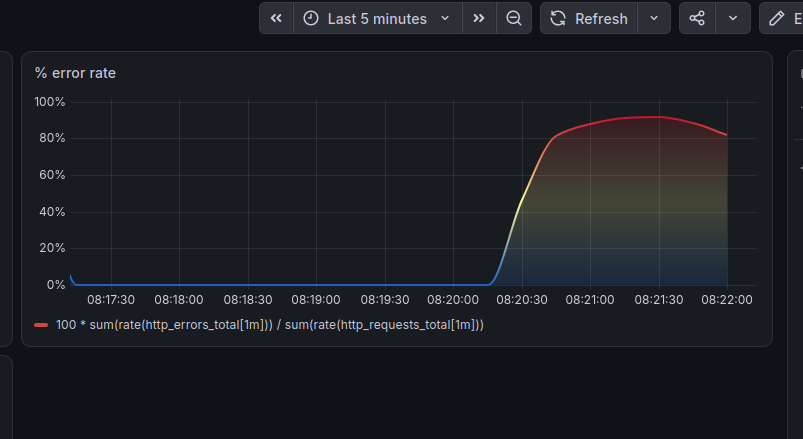

Видно всплеск ошибок в Grafana. В Alertmanager появляется алерт:

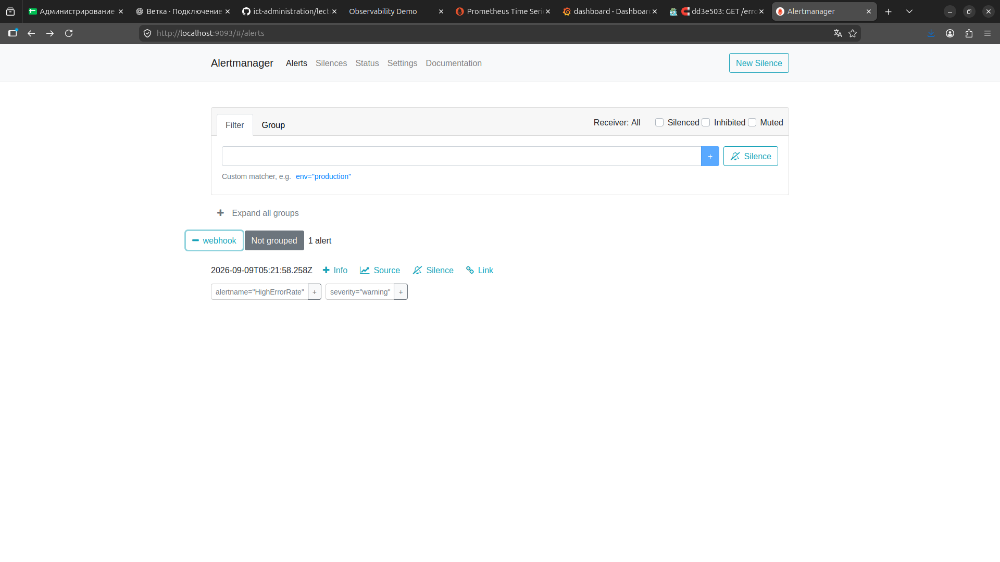

А также алерт возникает в логах вебхука:

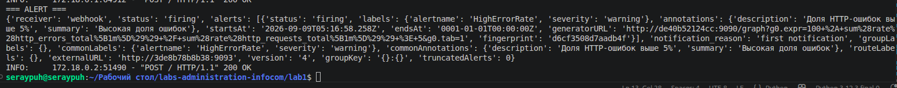

Потом начинаем таким же способом вызывать задержку, и нам приходит алерт уже о ней. Вот как это выглядит в прометеусе:

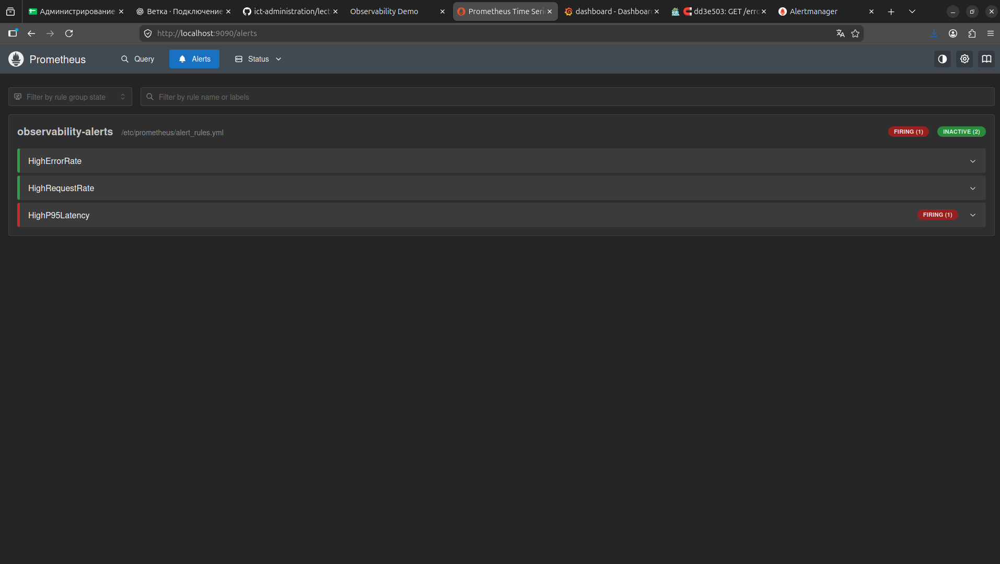

Когда алерт переходит в состояние FIRING, то тогда он высылается.

Теперь с нагрузкой то же самое:

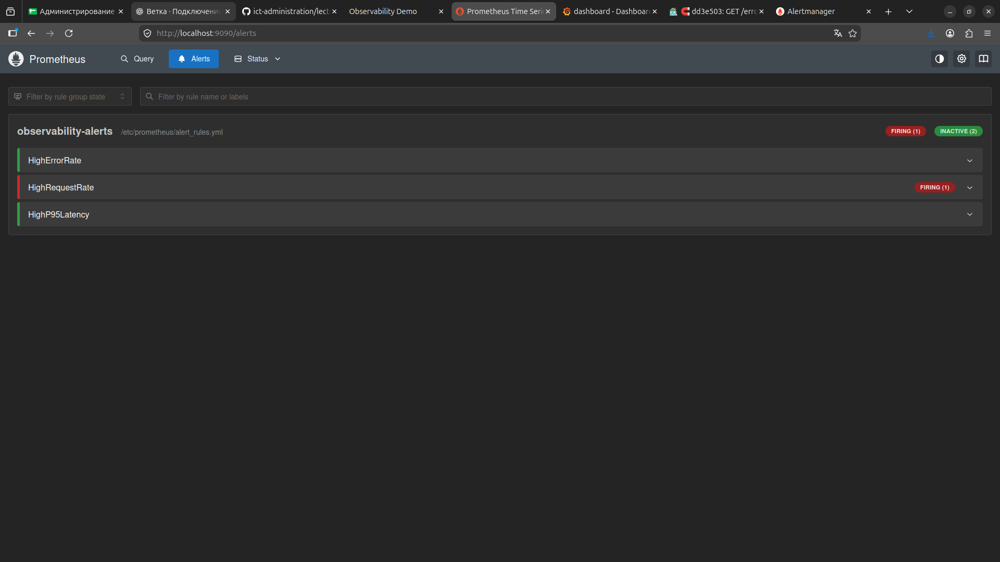

А вот как выглядит алерт раскрытый в Alertmanager:

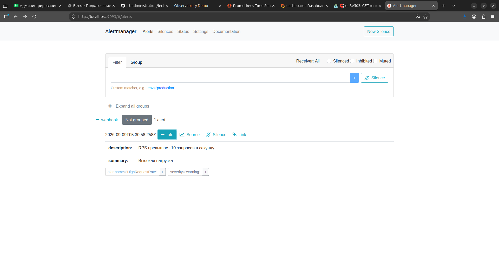

Ну и вот все три алерта в логах вебхука:

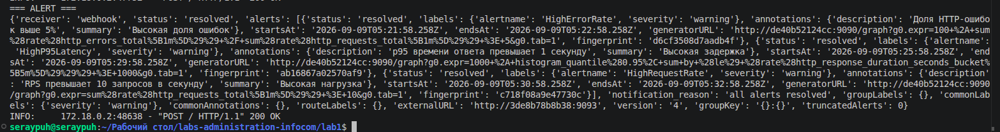

Да, терминал в vs code не структурирует JSON -_- Но если приглядеться, то все три тут есть.

# Заключение

В данной лабораторной работе была поднята инфраструктура алертинга и мониторинга. В этом было достаточно проблематично разобраться во всём и сразу, но это только моё мнение, возможно остальным всё далось куда легче. Как бы то ни было, в лабораторной была разобрана важная составляющая DevOps/SRE, которая будет полезна в будущем.

# КОНФИГИ

## docker-compose.yml

```
services:
  app:
    build: .
    container_name: observability-app
    ports:
      - "8000:8000"
    environment:
      OTEL_EXPORTER_OTLP_ENDPOINT: http://otel-collector:4317

    depends_on:
      - otel-collector

  prometheus:
    image: prom/prometheus
    container_name: prometheus
    ports:
      - "9090:9090"
    volumes:
      - ./prometheus/prometheus.yml:/etc/prometheus/prometheus.yml
      - ./alert_rules.yml:/etc/prometheus/alert_rules.yml
    depends_on:
      - app

  grafana:
    image: grafana/grafana
    container_name: grafana
    ports:
      - "3000:3000"
    volumes:
      - grafana-data:/var/lib/grafana
    depends_on:
      - prometheus

  loki:
    image: grafana/loki:3.7.0
    container_name: loki
    ports:
      - "3100:3100"
    volumes:
      - ./loki/loki-config.yml:/etc/loki/config.yml
      - loki-data:/loki
    command: -config.file=/etc/loki/config.yml

  promtail:
    image: grafana/promtail:3.6.11
    container_name: promtail
    volumes:
      - ./promtail/promtail-config.yml:/etc/promtail/config.yml
      - /var/lib/docker/containers:/var/lib/docker/containers:ro
    command: -config.file=/etc/promtail/config.yml
    depends_on:
      - loki

  otel-collector:
    image: otel/opentelemetry-collector-contrib:latest
    container_name: otel-collector
    ports:
      - "4317:4317"
      - "4318:4318"
    volumes:
      - ./otel-collector-config.yml:/etc/otelcol-contrib/config.yaml
    command:
      - "--config=/etc/otelcol-contrib/config.yaml"
    
  jaeger:
    image: jaegertracing/jaeger:2.20.0
    container_name: jaeger
    ports:
      - "16686:16686"
  
  alertmanager:
    image: prom/alertmanager
    container_name: alertmanager

    ports:
      - "9093:9093"

    volumes:
      - ./alertmanager.yml:/etc/alertmanager/alertmanager.yml

    command:
      - "--config.file=/etc/alertmanager/alertmanager.yml"

  webhook:
    image: python:3.13-slim
    container_name: webhook

    working_dir: /app

    volumes:
      - ./webhook.py:/app/webhook.py

    ports:
      - "5001:5001"

    command: >
      sh -c "pip install fastapi uvicorn &&
            uvicorn webhook:app --host 0.0.0.0 --port 5001"

volumes:
  grafana-data:
  loki-data:
```

## Dockerfile

```
FROM python:3.13-slim

WORKDIR /app

COPY requirements.txt .

RUN pip install --no-cache-dir -r requirements.txt

COPY app ./app

EXPOSE 8000

CMD ["uvicorn", "app.main:app", "--host", "0.0.0.0", "--port", "8000"]
```

## prometheus.yml

```
global:
  scrape_interval: 5s

scrape_configs:
  - job_name: "observability-demo"
    static_configs:
      - targets: ["app:8000"]

rule_files:
  - /etc/prometheus/alert_rules.yml

alerting:
  alertmanagers:
    - static_configs:
        - targets:
            - alertmanager:9093
```

## loki-config.yml

```
auth_enabled: false

server:
  http_listen_port: 3100

common:
  path_prefix: /loki

  ring:
    instance_addr: 127.0.0.1
    kvstore:
      store: inmemory

  replication_factor: 1

  storage:
    filesystem:
      chunks_directory: /loki/chunks
      rules_directory: /loki/rules

schema_config:
  configs:
    - from: 2024-01-01
      store: tsdb
      object_store: filesystem
      schema: v13
      index:
        prefix: index_
        period: 24h

limits_config:
  allow_structured_metadata: true
  volume_enabled: true

ruler:
  enable_api: true
```

## promtail-config.yml

```
server:
  http_listen_port: 9080

positions:
  filename: /tmp/positions.yaml

clients:
  - url: http://loki:3100/loki/api/v1/push

scrape_configs:

  - job_name: docker

    static_configs:
      - targets:
          - localhost

        labels:
          job: docker
          __path__: /var/lib/docker/containers/*/*-json.log
```

## otel-collector-config.yml

```
receivers:
  otlp:
    protocols:
      grpc:
        endpoint: 0.0.0.0:4317
      http:
        endpoint: 0.0.0.0:4318


exporters:
  debug:
    verbosity: detailed

  otlp/jaeger:
    endpoint: jaeger:4317
    tls:
      insecure: true


service:
  pipelines:
    traces:
      receivers:
        - otlp

      exporters:
        - debug
        - otlp/jaeger
```

## alert_rules.yml

```
groups:
  - name: observability-alerts

    rules:

      - alert: HighErrorRate
        expr: |
          100 *
          sum(rate(http_errors_total[1m]))
          /
          sum(rate(http_requests_total[1m]))
          > 5
        for: 30s
        labels:
          severity: warning
        annotations:
          summary: "Высокая доля ошибок"
          description: "Доля HTTP-ошибок выше 5%"

      - alert: HighRequestRate
        expr: |
          sum(rate(http_requests_total[1m])) > 10
        for: 30s
        labels:
          severity: warning
        annotations:
          summary: "Высокая нагрузка"
          description: "RPS превышает 10 запросов в секунду"

      - alert: HighP95Latency
        expr: |
          1000 *
          histogram_quantile(
            0.95,
            sum by (le) (
              rate(http_response_duration_seconds_bucket[5m])
            )
          ) > 1000
        for: 30s
        labels:
          severity: warning
        annotations:
          summary: "Высокая задержка"
          description: "p95 времени ответа превышает 1 секунду"
```

## alertmanager.yml

```
global:
  resolve_timeout: 1m

route:
  receiver: webhook

receivers:
  - name: webhook
    webhook_configs:
      - url: http://webhook:5001/
```

## ну и webhook.py (тоже был написан нейронкой, как и main.py)

```
from fastapi import FastAPI, Request

app = FastAPI()


@app.post("/")
async def webhook(request: Request):
    data = await request.json()

    print("=== ALERT ===")
    print(data)

    return {"status": "ok"}
```

