# Отчёт ЛР2

## Цель работы

Научиться работать с Kafka на примере сгеренированного сервиса создания заказов и сервиса приёма заказов.

# Часть 1

Нейронкой были сгенерированы user service и picker service. У них кстати получились идентичные Dockerfile:

```
FROM node:18-alpine
WORKDIR /app
COPY package*.json ./
RUN npm install
COPY . .
EXPOSE 3001
CMD ["node", "index.js"]
```

В `.env` были вынесены переменные:

```
# Общие настройки Kafka
KAFKA_BROKER=kafka:29092
KAFKA_TOPIC=orders

# Настройки для Picker Service
KAFKA_GROUP_ID=picker-group
PICKER_1_NAME=picker-1

KAFKA_PARTITIONS=3
```

Добавляем сервисы в `docker compose`:

```
  user-service:
    build: ./user-service
    container_name: user-service
    ports:
      - "3000:3000"
    environment:
      PORT: 3000
      KAFKA_BROKER: ${KAFKA_BROKER}
      KAFKA_TOPIC: ${KAFKA_TOPIC}
    depends_on:
      - kafka
      - init-kafka

  picker-service:
    build: ./picker-service
    container_name: picker-service
    ports:
      - "3001:3001"
    environment:
      PORT: 3001
      KAFKA_BROKER: ${KAFKA_BROKER}
      KAFKA_TOPIC: ${KAFKA_TOPIC}
      KAFKA_GROUP_ID: ${KAFKA_GROUP_ID}
      INSTANCE_NAME: ${PICKER_1_NAME}
    depends_on:
      - kafka
      - init-kafka
```

# Часть 2

Добавляем кафку в `docker-compose.yml`:

```
  kafka:
    image: confluentinc/cp-kafka:7.5.0
    container_name: kafka
    ports:
      - "9092:9092"
    environment:
      KAFKA_NODE_ID: 1
      KAFKA_LISTENER_SECURITY_PROTOCOL_MAP: 'CONTROLLER:PLAINTEXT,PLAINTEXT:PLAINTEXT,PLAINTEXT_HOST:PLAINTEXT'
      KAFKA_ADVERTISED_LISTENERS: 'PLAINTEXT://kafka:29092,PLAINTEXT_HOST://localhost:9092'
      KAFKA_OFFSETS_TOPIC_REPLICATION_FACTOR: 1
      KAFKA_GROUP_INITIAL_REBALANCE_DELAY_MS: 0
      KAFKA_TRANSACTION_STATE_LOG_MIN_ISR: 1
      KAFKA_TRANSACTION_STATE_LOG_REPLICATION_FACTOR: 1
      KAFKA_PROCESS_ROLES: 'broker,controller'
      KAFKA_CONTROLLER_QUORUM_VOTERS: '1@kafka:29093'
      KAFKA_LISTENERS: 'PLAINTEXT://0.0.0.0:29092,CONTROLLER://0.0.0.0:29093,PLAINTEXT_HOST://0.0.0.0:9092'
      KAFKA_INTER_BROKER_LISTENER_NAME: 'PLAINTEXT'
      KAFKA_CONTROLLER_LISTENER_NAMES: 'CONTROLLER'
      KAFKA_LOG_DIRS: '/tmp/kraft-combined-logs'
      CLUSTER_ID: 'MkU3OEVBNTcwNTJENDM2Qk'
      KAFKA_AUTO_CREATE_TOPICS_ENABLE: 'true'
      # Если Kafka создаст топик автоматически, она сразу сделает столько партиций:
      KAFKA_NUM_PARTITIONS: ${KAFKA_PARTITIONS}
```

Ещё важно отметить, что я поднял Kafka UI уже на этом этапе, о том что это нужно было сделать только в 4 части я узнал лишь в тот момент, когда я дошел до 4 части...

Тем не менее, нужно было создать топик `orders`:

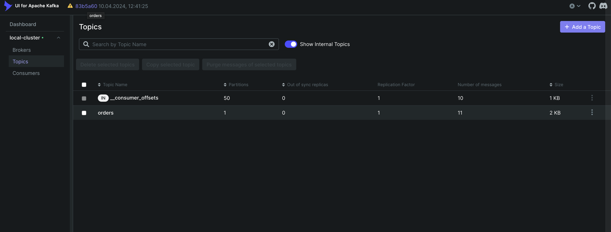

В user service были созданы заказы:

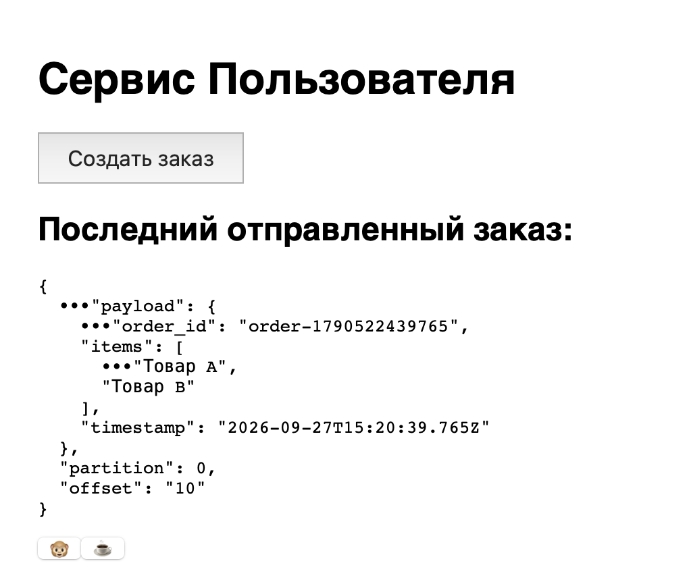

А вот так выглядят заказы в picker service:

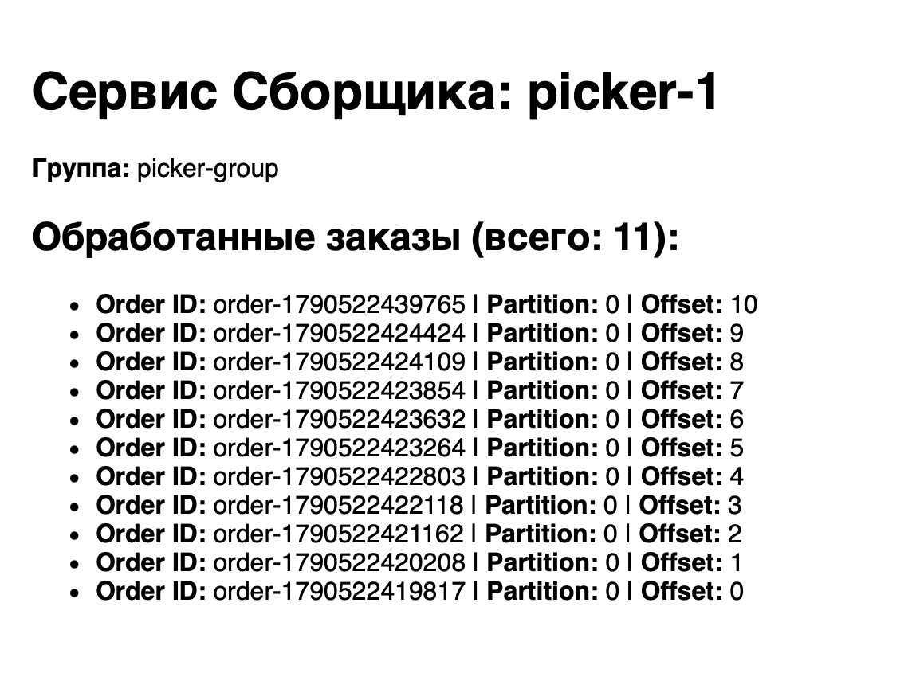

# Часть 3

В этой части нужно было решать бизнес-ситуации через конфигурацию.

### Ситуация 1

Нужно было увеличить количество партиций. Я это сделал следующим образом: внёс в `.env` количество партиций, и создал в `docker-compose` контейнер `init-kafka`:

```
init-kafka:
    image: confluentinc/cp-kafka:7.5.0
    container_name: init-kafka
    depends_on:
      - kafka
    entrypoint: [ '/bin/sh', '-c' ]
    command: >
      bash -c "
      echo 'Ждем готовности Kafka...';
      cub kafka-ready -b ${KAFKA_BROKER} 1 30;
      echo 'Kafka готова! Настраиваем топик...';
      kafka-topics --bootstrap-server ${KAFKA_BROKER} --create --if-not-exists --topic ${KAFKA_TOPIC} --partitions ${KAFKA_PARTITIONS} --replication-factor 1;
      kafka-topics --bootstrap-server ${KAFKA_BROKER} --alter --topic ${KAFKA_TOPIC} --partitions ${KAFKA_PARTITIONS};
      echo 'Топик ${KAFKA_TOPIC} настроен на ${KAFKA_PARTITIONS} партиций!';
      "
```

Этот контейнер нужен, потому что `depends-on` не дожидается готовности сервера, и по другому не получалось создать 3 партиции. Теперь после удаления топика и перезапуска партиции будет 3.

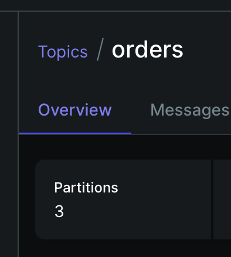

### Ситуация 2

Здесь нужно было создавать новые сборщики и смотреть что будет.

Для начала создадим один новый сборщик: `docker compose up -d --scale picker-service=2`. После этого создаём несколько заказов и смотрим как они распределяются между сервисами:

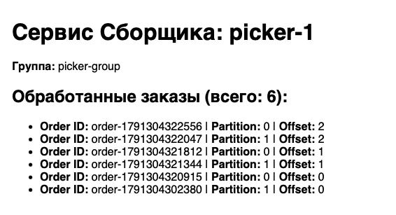

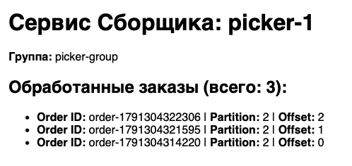

Как можно заметить, на первый сборщик летят заказы из партиций 0 и 1, а на второй из партиции 2. Если верить ИИ, то партиции распределяются по стратегии RoundRobinAssigner.

Теперь мы поднимем 4 сборщика, чтобы их было на один больше чем партиций:

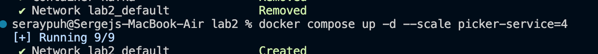

Первые три сборщика заберут себе по одной партиции, а четвёртый будет просто простаивать:


### Ситуация 3

А здесь нужно было уронить сборщик, создать заказы и доказать что они не пропали. Что-ж, так и поступим, выключаем сборщик:

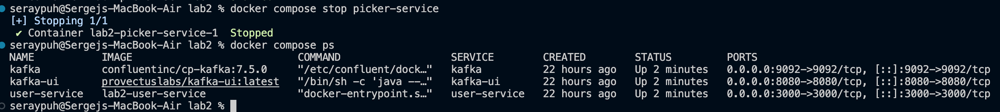

Создаём заказ, а потом включаем сборщик, но без `-d` в команде, чтобы смотреть что происходит:

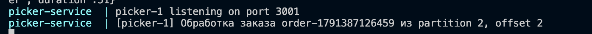

Как только сборщик влючился, он срзу подтянул созданный заказ и обработал.

# Часть 4

В этой части нужно было поднять Kafka UI, но как я говорил ранее, я поднял её еще вместе с кафкой.

# Часть 5

В этой части нужно было решать бизнес-ситуацию через Kafka UI.

### Ситуация 1

В этой ситуации нужно было найти конкретный заказ по номеру. Создаём заказ в user service и запоминаем его номер:

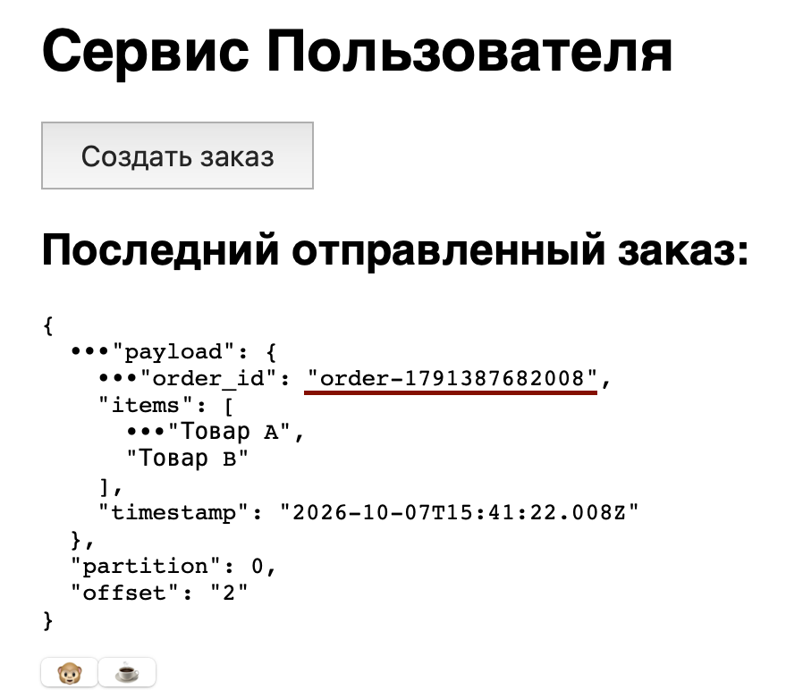

Теперь идем в UI и находим тот самый заказ в топике:

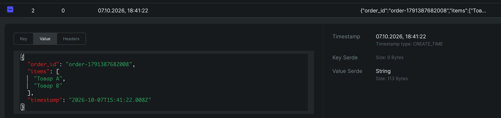

Если что цифры 2 и 0 вверху скриншота это offset и partition.

А вот нулевой consumer lag у consumer group, что свидетельствует о том что заказ обработан:

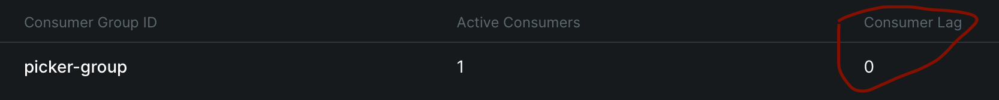

### Ситуация 2

Здесь надо было стбросить оффсет и посмотреть как заказы заново обрабатываются. Сбросим оффсеты через UI:

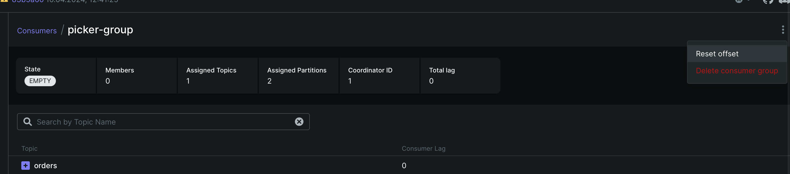

После этого все заказы заново обработались в picer service:

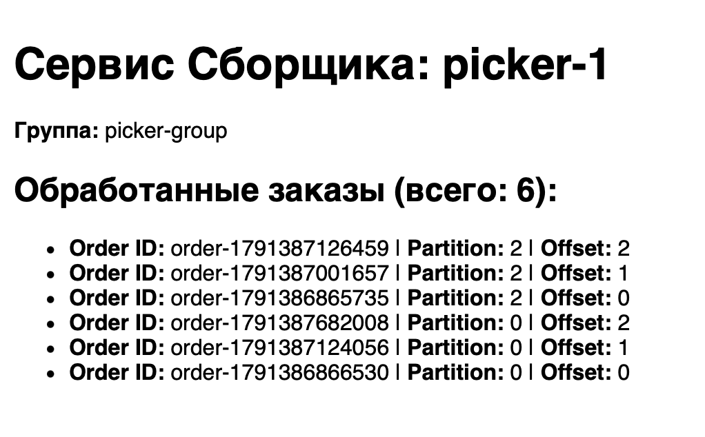

### Ситуация 3

А здесь нужно было усеньшить срок хранения заказов. Для этого нужно было в настройках топика уменьшить параметр `retention.ms`:

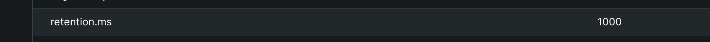

Я поставил одну секунду чтоб сразу показать, что заказы будут удаляться. Теперь заходим в messages и видим что все заказы пропали, потому что они существуют уже дольше одной секунды:

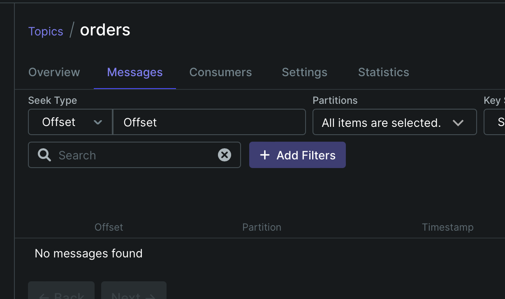

# Часть 6

В этой части был подключен мониторинг: prometheus и grafana. Создаём файл `prometheus.yml`:

```
global:
  scrape_interval: 5s

scrape_configs:
  - job_name: 'kafka-exporter'
    static_configs:
      - targets: ['kafka-exporter:9308']

```

И добавляем в docker compose сборщик телеметрии для кафки, прометеус и графану:

```
  kafka-exporter:
    image: danielqsj/kafka-exporter:latest
    container_name: kafka-exporter
    command: ["--kafka.server=kafka:29092"]
    ports:
      - "9308:9308"
    depends_on:
      - kafka

  prometheus:
    image: prom/prometheus:latest
    container_name: prometheus
    volumes:
      - ./prometheus.yml:/etc/prometheus/prometheus.yml
    ports:
      - "9090:9090"
    depends_on:
      - kafka-exporter

  grafana:
    image: grafana/grafana:latest
    container_name: grafana
    ports:
      - "3005:3000"
    environment:
      - GF_SECURITY_ADMIN_PASSWORD=admin
    depends_on:
      - prometheus
```

Запускаем, выбираем в grafana как источник данных prometheus, и мы готовы собирать дашборд.

Какие метрики я хотел добавить в дашборд:
- Интенсивность входных сообщений
- Интенсивность обработки сообщений
- consumer lag
- количество партиций

Нейросеть мне подсказала что оказывается необязательно каждый раз с нуля делать дашборды в графане. Для популярных сборщиков метрик существуют шаблоны. Так например для Kafka-exporter есть дашборд в котором есть всё то, что я хотел добавить. Для этого нужно импортировать дашборд с номером 7589:

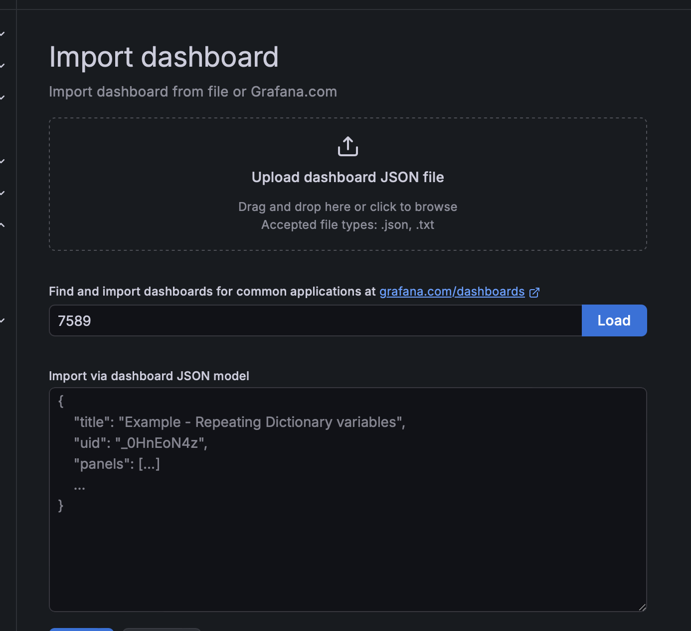

И вот собственно сам дашборд:

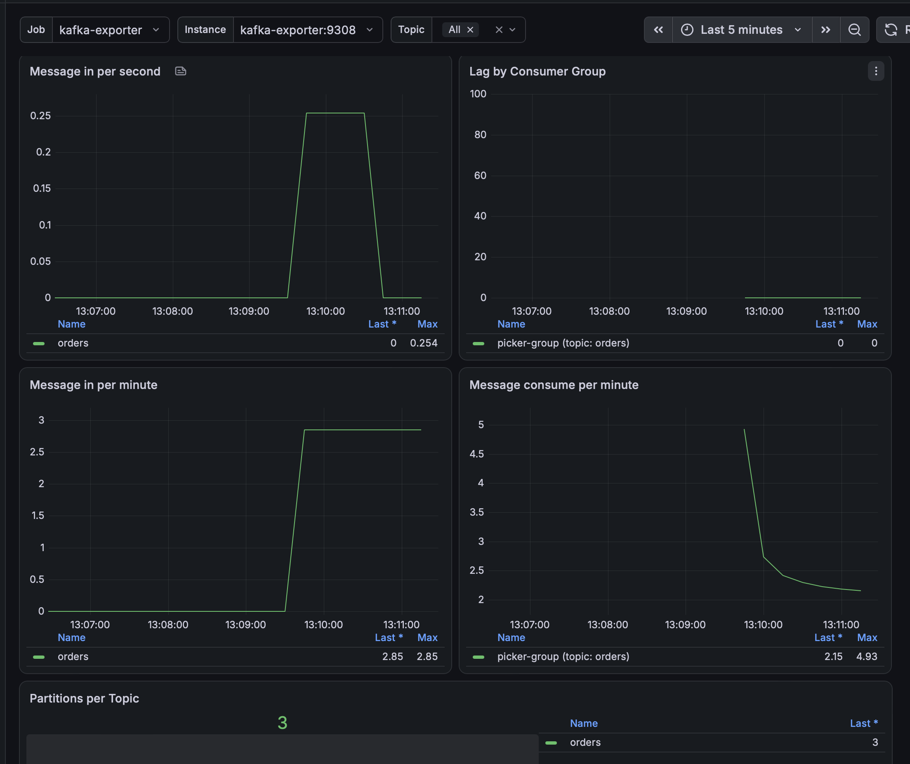

Если говорить об алертах, то ставить их нужно:
- во-первых на consumer lag, потому что это главный показатель того, что кафка перестаёт справляться
- во-вторых на message consume per <отрезок времени в зависимости от размера проекта>, если он падает до нуля, то скорее всего обработка сообщений перестала работать
- в-третьих на message in per <отрезок времени>, если при ожидаемой нагрузке поток неожиданно падает.

# Заключение

В ходе выполнения данной лабораторной работой мы узнали что такое брокеры, научились работать с Kafka и познакомились с её понятиями. Из трудностей могу отметить проблемы, возникавшие у меня с докером: не создавались партиции из-за того, что докер не дожидался готовности контейнеров в depends-on и ти ли из настроек по умолчанию, то ли непонятно откуда (я так и не разобрался) подтягивал для партиций значение 1 и запускал. По итогу пришлось создавать контейнер init-kafka в котором происывать количество партиций. Благо ИИ помог мне с этим и я пошёл дальше. В дальнейшем проблем либо не возникало, либо я уже забыл, ибо что-то несущественное.

# Файлы

## picker service

### Dockerfile

```
FROM node:18-alpine
WORKDIR /app
COPY package*.json ./
RUN npm install
COPY . .
EXPOSE 3001
CMD ["node", "index.js"]
```

### index.js

```
const express = require('express');
const { Kafka } = require('kafkajs');

const app = express();
const PORT = process.env.PORT || 3001;
const KAFKA_BROKER = process.env.KAFKA_BROKER || 'localhost:9092';
const TOPIC = process.env.KAFKA_TOPIC || 'orders';
const GROUP_ID = process.env.KAFKA_GROUP_ID || 'picker-group';
const INSTANCE_NAME = process.env.INSTANCE_NAME || 'picker-1';

const kafka = new Kafka({
  clientId: INSTANCE_NAME,
  brokers: [KAFKA_BROKER]
});

const consumer = kafka.consumer({ groupId: GROUP_ID });
const processedOrders = [];

app.get('/', (req, res) => {
  res.send(`
    <!DOCTYPE html>
    <html>
    <head><title>Picker Service - ${INSTANCE_NAME}</title></head>
    <body style="font-family: sans-serif; padding: 20px;">
      <h1>Сервис Сборщика: ${INSTANCE_NAME}</h1>
      <p><b>Группа:</b> ${GROUP_ID}</p>
      <h2>Обработанные заказы (всего: ${processedOrders.length}):</h2>
      <ul>
        ${processedOrders.map(o => `<li>
          <b>Order ID:</b> ${o.order_id} | 
          <b>Partition:</b> ${o.partition} | 
          <b>Offset:</b> ${o.offset}
        </li>`).reverse().join('')}
      </ul>
    </body>
    </html>
  `);
});

async function start() {
  let connected = false;
  while (!connected) {
    try {
      await consumer.connect();
      connected = true;
      console.log('Successfully connected to Kafka');
    } catch (err) {
      console.log('Kafka not ready yet, retrying in 3 seconds...');
      await new Promise(resolve => setTimeout(resolve, 3000));
    }
  }

  // Повторяем попытку подписки, пока топик orders не будет создан
  let subscribed = false;
  while (!subscribed) {
    try {
      await consumer.subscribe({ topic: TOPIC, fromBeginning: true });
      subscribed = true;
      console.log(`Successfully subscribed to topic: ${TOPIC}`);
    } catch (err) {
      console.log(`Topic ${TOPIC} not ready yet, retrying in 3 seconds...`);
      await new Promise(resolve => setTimeout(resolve, 3000));
    }
  }

  await consumer.run({
    eachMessage: async ({ topic, partition, message }) => {
      const order = JSON.parse(message.value.toString());
      console.log(`[${INSTANCE_NAME}] Обработка заказа ${order.order_id} из partition ${partition}, offset ${message.offset}`);
      
      await new Promise(resolve => setTimeout(resolve, 500));

      processedOrders.push({
        order_id: order.order_id,
        partition,
        offset: message.offset
      });
    }
  });

  app.listen(PORT, () => {
    console.log(`${INSTANCE_NAME} listening on port ${PORT}`);
  });
}

start();
```

### package.json

```
{
  "name": "picker-service",
  "version": "1.0.0",
  "main": "index.js",
  "dependencies": {
    "express": "^4.18.2",
    "kafkajs": "^2.2.4"
  }
}
```

## user service

### Dockerfile

```
FROM node:18-alpine
WORKDIR /app
COPY package*.json ./
RUN npm install
COPY . .
EXPOSE 3000
CMD ["node", "index.js"]
```

### index.js

```
const express = require('express');
const { Kafka } = require('kafkajs');

const app = express();
app.use(express.json());
app.use(express.urlencoded({ extended: true }));

const PORT = process.env.PORT || 3000;
const KAFKA_BROKER = process.env.KAFKA_BROKER || 'localhost:9092';
const TOPIC = process.env.KAFKA_TOPIC || 'orders';

const kafka = new Kafka({
  clientId: 'user-service',
  brokers: [KAFKA_BROKER]
});

const producer = kafka.producer();

let lastSentLog = null;

app.get('/', (req, res) => {
  res.send(`
    <!DOCTYPE html>
    <html>
    <head><title>User Service - Создание заказа</title></head>
    <body style="font-family: sans-serif; padding: 20px;">
      <h1>Сервис Пользователя</h1>
      <form action="/create-order" method="POST">
        <button type="submit" style="padding: 10px 20px; font-size: 16px;">Создать заказ</button>
      </form>
      <h2>Последний отправленный заказ:</h2>
      <pre>${lastSentLog ? JSON.stringify(lastSentLog, null, 2) : 'Заказов ещё не было'}</pre>
    </body>
    </html>
  `);
});

app.post('/create-order', async (req, res) => {
  const orderId = `order-${Date.now()}`;
  const payload = {
    order_id: orderId,
    items: ['Товар A', 'Товар B'],
    timestamp: new Date().toISOString()
  };

  try {
    const result = await producer.send({
      topic: TOPIC,
      messages: [{ value: JSON.stringify(payload) }]
    });

    lastSentLog = {
      payload,
      partition: result[0].partition,
      offset: result[0].baseOffset
    };

    res.redirect('/');
  } catch (err) {
    res.status(500).send(`Ошибка отправки: ${err.message}`);
  }
});

async function start() {
  let connected = false;
  while (!connected) {
    try {
      await producer.connect();
      connected = true;
      console.log('Successfully connected to Kafka');
    } catch (err) {
      console.log('Kafka not ready yet, retrying in 3 seconds...');
      await new Promise(resolve => setTimeout(resolve, 3000));
    }
  }

  app.listen(PORT, () => {
    console.log(`User service listening on port ${PORT}`);
  });
}

start();
```

### package.json

```{
  "name": "user-service",
  "version": "1.0.0",
  "main": "index.js",
  "dependencies": {
    "express": "^4.18.2",
    "kafkajs": "^2.2.4"
  }
}
```

## .env

```
# Общие настройки Kafka
KAFKA_BROKER=kafka:29092
KAFKA_TOPIC=orders

# Настройки для Picker Service
KAFKA_GROUP_ID=picker-group
PICKER_1_NAME=picker-1

KAFKA_PARTITIONS=3
```

## prometheus.yml

```
global:
  scrape_interval: 5s

scrape_configs:
  - job_name: 'kafka-exporter'
    static_configs:
      - targets: ['kafka-exporter:9308']
```

## docker-compose.yml

```
services:
  kafka:
    image: confluentinc/cp-kafka:7.5.0
    container_name: kafka
    ports:
      - "9092:9092"
    environment:
      KAFKA_NODE_ID: 1
      KAFKA_LISTENER_SECURITY_PROTOCOL_MAP: 'CONTROLLER:PLAINTEXT,PLAINTEXT:PLAINTEXT,PLAINTEXT_HOST:PLAINTEXT'
      KAFKA_ADVERTISED_LISTENERS: 'PLAINTEXT://kafka:29092,PLAINTEXT_HOST://localhost:9092'
      KAFKA_OFFSETS_TOPIC_REPLICATION_FACTOR: 1
      KAFKA_GROUP_INITIAL_REBALANCE_DELAY_MS: 0
      KAFKA_TRANSACTION_STATE_LOG_MIN_ISR: 1
      KAFKA_TRANSACTION_STATE_LOG_REPLICATION_FACTOR: 1
      KAFKA_PROCESS_ROLES: 'broker,controller'
      KAFKA_CONTROLLER_QUORUM_VOTERS: '1@kafka:29093'
      KAFKA_LISTENERS: 'PLAINTEXT://0.0.0.0:29092,CONTROLLER://0.0.0.0:29093,PLAINTEXT_HOST://0.0.0.0:9092'
      KAFKA_INTER_BROKER_LISTENER_NAME: 'PLAINTEXT'
      KAFKA_CONTROLLER_LISTENER_NAMES: 'CONTROLLER'
      KAFKA_LOG_DIRS: '/tmp/kraft-combined-logs'
      CLUSTER_ID: 'MkU3OEVBNTcwNTJENDM2Qk'
      KAFKA_AUTO_CREATE_TOPICS_ENABLE: 'true'
      # Если Kafka создаст топик автоматически, она сразу сделает столько партиций:
      KAFKA_NUM_PARTITIONS: ${KAFKA_PARTITIONS}

  init-kafka:
    image: confluentinc/cp-kafka:7.5.0
    container_name: init-kafka
    depends_on:
      - kafka
    entrypoint: [ '/bin/sh', '-c' ]
    command: >
      bash -c "
      echo 'Ждем готовности Kafka...';
      cub kafka-ready -b ${KAFKA_BROKER} 1 30;
      echo 'Kafka готова! Настраиваем топик...';
      kafka-topics --bootstrap-server ${KAFKA_BROKER} --create --if-not-exists --topic ${KAFKA_TOPIC} --partitions ${KAFKA_PARTITIONS} --replication-factor 1;
      kafka-topics --bootstrap-server ${KAFKA_BROKER} --alter --topic ${KAFKA_TOPIC} --partitions ${KAFKA_PARTITIONS};
      echo 'Топик ${KAFKA_TOPIC} настроен на ${KAFKA_PARTITIONS} партиций!';
      "

  kafka-ui:
    image: provectuslabs/kafka-ui:latest
    container_name: kafka-ui
    ports:
      - "8080:8080"
    environment:
      KAFKA_CLUSTERS_0_NAME: local-cluster
      KAFKA_CLUSTERS_0_BOOTSTRAPSERVERS: ${KAFKA_BROKER}
    depends_on:
      - kafka

  user-service:
    build: ./user-service
    container_name: user-service
    ports:
      - "3000:3000"
    environment:
      PORT: 3000
      KAFKA_BROKER: ${KAFKA_BROKER}
      KAFKA_TOPIC: ${KAFKA_TOPIC}
    depends_on:
      - kafka
      - init-kafka

  picker-service:
    build: ./picker-service
    container_name: picker-service
    ports:
      - "3001:3001"
    environment:
      PORT: 3001
      KAFKA_BROKER: ${KAFKA_BROKER}
      KAFKA_TOPIC: ${KAFKA_TOPIC}
      KAFKA_GROUP_ID: ${KAFKA_GROUP_ID}
      INSTANCE_NAME: ${PICKER_1_NAME}
    depends_on:
      - kafka
      - init-kafka
  
  kafka-exporter:
    image: danielqsj/kafka-exporter:latest
    container_name: kafka-exporter
    command: ["--kafka.server=kafka:29092"]
    ports:
      - "9308:9308"
    depends_on:
      - kafka

  prometheus:
    image: prom/prometheus:latest
    container_name: prometheus
    volumes:
      - ./prometheus.yml:/etc/prometheus/prometheus.yml
    ports:
      - "9090:9090"
    depends_on:
      - kafka-exporter

  grafana:
    image: grafana/grafana:latest
    container_name: grafana
    ports:
      - "3005:3000"
    environment:
      - GF_SECURITY_ADMIN_PASSWORD=admin
    depends_on:
      - prometheus
```